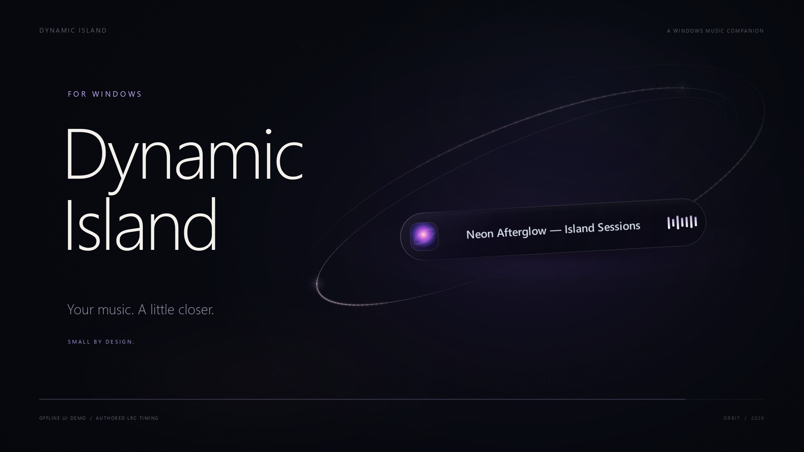
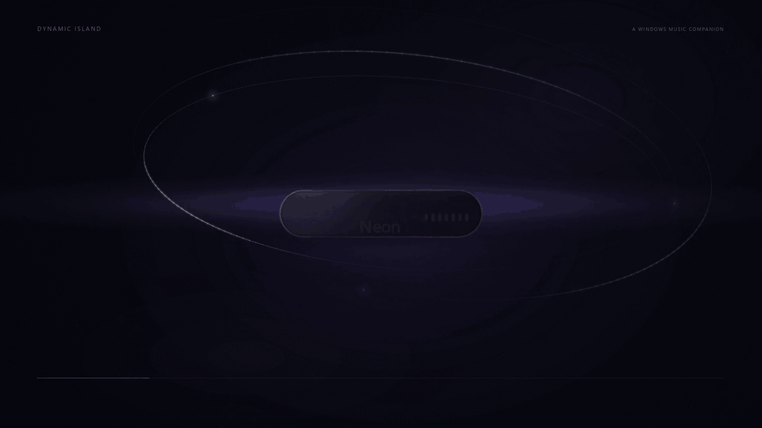
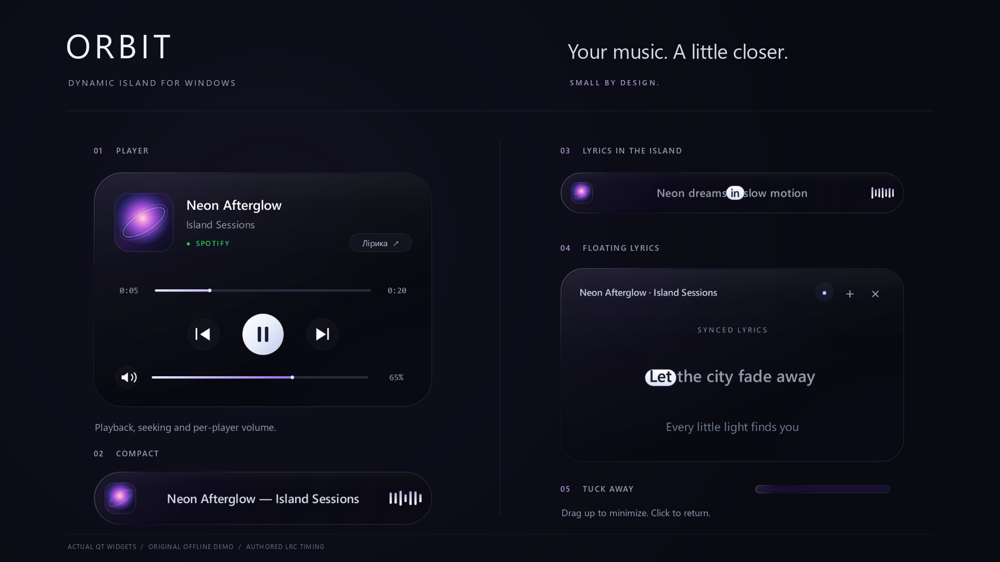

<div align="center">

# ORBIT

### Dynamic Island для Windows

**Музика поруч. Робочий стіл — твій.**

Компактний плеєр із плавною анімацією, керуванням відтворенням і живою лірикою.

[English](../README.md) · **Українська** · [Завантаження](https://github.com/DeFexNN/orbit-island/releases/latest) · [Кінематографічне інтро](https://github.com/DeFexNN/orbit-island/releases/latest/download/ORBIT-Cinematic-Intro.mp4)



</div>

ORBIT тримає поточний трек у верхній частині екрана й розгортає керування одним кліком. Обкладинка задає відтінок темного скляного інтерфейсу, пружинні переходи поєднують стани, а лірика рухається разом із відтворенням.

Застосунок написаний на Python і PyQt6. Дані та команди відтворення проходять через медіасесії Windows; Spotify Desktop має пріоритет. Для цього не потрібні ключі Spotify API.



## Що вміє ORBIT

| Можливість | Як це працює |
| :--- | :--- |
| Компактний острівець | Обкладинка, назва треку та стан відтворення поверх інших вікон. |
| Розгорнутий плеєр | Пауза, відтворення, попередній і наступний треки та перемотування. |
| Гучність плеєра | Зміна гучності й вимкнення звуку для розпізнаної аудіосесії. |
| Синхронізована лірика | Пошук через LRCLIB або імпорт власного файлу `.lrc`. |
| Плаваюча лірика | Окреме вікно, яке можна перетягувати за верхню частину. |
| Згортання в смужку | Жест угору прибирає острівець до краю екрана; клік повертає його. |
| Демо без відтворення | Авторський тестовий трек, обкладинка та лірика для огляду інтерфейсу. |

Інтерфейс і контекстні меню зараз українською.

## Почати за кілька хвилин

Потрібні **Windows**, **Python 3.12 x64** та Git. Залежності встановлюються в окреме віртуальне середовище. Виконай у PowerShell:

```powershell
git clone https://github.com/DeFexNN/orbit-island.git
cd orbit-island
py -3.12 -m venv .venv
.\.venv\Scripts\python.exe -m pip install -r requirements.txt
.\.venv\Scripts\python.exe main.py
```

Запусти музику в Spotify Desktop або сумісному плеєрі, який надає медіасесію Windows. ORBIT підхопить доступну сесію; якщо доступної медіасесії немає, острівець залишиться в стані очікування. Поставлений на паузу трек може й далі показувати назву та обкладинку.

Для наступних запусків достатньо останньої команди з папки репозиторію.

### Подивитися інтерфейс без музики

```powershell
.\.venv\Scripts\python.exe main.py --demo
```

Демо використовує «Neon Afterglow / Island Sessions» та авторські часові мітки лірики. Його кнопки показують поведінку інтерфейсу; гучність не змінює реальний звук. Клік на обкладинці може відкрити Spotify.

## Керування

| Дія | Результат |
| :--- | :--- |
| Клік на фоні острівця | Розгорнути або згорнути плеєр, коли доступний трек. |
| Клік на обкладинці | Відкрити або вивести вперед Spotify Desktop. |
| Перетягування острівця вгору | Згорнути в тонку смужку. |
| Клік на смужці | Відновити попередній стан. |
| Правий клік на острівці | Відкрити меню плаваючої лірики, імпорту `.lrc` та оновлення лірики. |
| Перетягування верхньої частини вікна лірики | Перемістити плаваючу лірику. |

У поточній версії меню виходу ще немає. Щоб завершити роботу, зупини відповідний процес Python у Диспетчері завдань Windows.



## Лірика: звідки беруться слова й таймінг

ORBIT шукає текст у LRCLIB за метаданими поточного треку. Наявність тексту та його точність залежать від записів у цьому сервісі.

- **Звичайний LRC** містить часові мітки рядків. Підсвічування окремих слів між ними обчислюється приблизно.
- **Enhanced LRC** може містити часові мітки слів, які застосунок використовує для точнішого підсвічування.
- **Власний `.lrc`** можна відкрити через контекстне меню; він має пріоритет над результатом пошуку для поточного треку.

Якщо для композиції немає синхронізованого тексту, ORBIT не може відновити точний таймінг із самого аудіо.

## Приватність

Для пошуку лірики застосунок надсилає **назву треку, виконавця, альбом і тривалість** до LRCLIB. Результати кешуються локально:

```text
%LOCALAPPDATA%\DynamicIslandWin\lyrics_cache.json
```

Читання стану плеєра та керування ним використовують локальні інтерфейси Windows. Авторизація в Spotify через ORBIT не потрібна.

## Кінематографічне інтро

[**Дивитися / завантажити ORBIT Cinematic Intro**](https://github.com/DeFexNN/orbit-island/releases/latest/download/ORBIT-Cinematic-Intro.mp4) — 32 секунди, 1920 × 1080, 60 кадрів/с, оригінальний стереосаундтрек із тональними переходами та скляними акцентами.

У кадрі — справжні віджети PyQt6, запущені на демонстраційних даних. Камера, світло й типографіка створені для фільму. Це окреме інтро, яке не запускається разом із застосунком.

Скрипти рендерингу, синтез звуку та команди відтворення проєкту — у [документації cinematic](../cinematic/README.md). Готове відео доступне серед файлів релізу.

## Поточні межі

- **v0.1.0 поширюється як вихідний код.** Готового інсталятора чи зібраного `.exe` поки немає.
- Команди відтворення й перемотування залежать від можливостей медіасесії конкретного плеєра.
- Гучність доступна, коли медіасесію вдається зіставити з аудіопроцесом; деякі упаковані застосунки можуть не підтримуватися.
- Анімована хвиля — декоративний елемент, а не аналізатор аудіосигналу.
- Скляна поверхня малюється застосунком; ефект не означає живе розмиття вмісту робочого столу.

## Розробка

Регресійні перевірки запускаються стандартним `unittest`:

```powershell
.\.venv\Scripts\python.exe -m unittest discover -s tests -v
```

Про проблему повідомляй через [Issues](https://github.com/DeFexNN/orbit-island/issues): додай версію Windows і Python, назву плеєра та кроки відтворення. Так простіше відрізнити поведінку ORBIT від обмежень медіасесії.

Оригінальний код і документація доступні за [ліцензією MIT](../LICENSE). Авторський саундтрек і код його синтезу мають окрему посвяту CC0. Залежності, системні шрифти та походження звуку описані в [THIRD_PARTY_NOTICES.md](../THIRD_PARTY_NOTICES.md).

<div align="center">

**ORBIT · Dynamic Island для Windows**<br>
Маленький простір для музики, яка зараз із тобою.

</div>
